# 00. Overview — Project Directory Sitemap & Routing Matrix

This document provides a complete directory map of the codebase and the route navigation matrix defined in `lib/main.dart`.

---

## 🌳 Codebase Directory Structure

```
lib/
├── main.dart                          # Application entry point, Hive initialization, GoRouter routes
├── firebase_options.dart              # Multiplatform Firebase options configuration
├── core/
│   ├── constants/
│   │   └── colors.dart                # AppColors: Inka Orange, Lime, Slate surfaces, and status tokens
│   ├── localization/
│   │   └── app_localizations.dart     # Multi-language translation maps (EN, TA, HI, ES)
│   ├── theme/
│   │   └── app_theme.dart             # Material 3 light & dark theme styling
│   └── utils/
│       ├── error_handler.dart         # Sanitized user-facing Firebase and runtime error handling
│       └── navigation_utils.dart      # Safe context navigation & route fallback helpers
├── data/
│   └── models/
│       ├── business_profile.dart      # BusinessProfile model & adapter (typeId: 4)
│       ├── client.dart                # Client model & adapter (typeId: 0)
│       ├── expense.dart               # Expense model & adapter (typeId: 6)
│       ├── invoice.dart               # Invoice model & adapter (typeId: 1)
│       ├── invoice_item.dart          # InvoiceItem model & adapter (typeId: 2)
│       ├── product.dart               # Product catalog model & adapter (typeId: 5)
│       ├── project.dart               # Project model & adapter (typeId: 8)
│       ├── subscription_plan.dart     # SubscriptionPlan & feature definitions
│       └── time_entry.dart            # TimeEntry model & adapter (typeId: 7)
├── presentation/
│   ├── providers/
│   │   ├── auth_provider.dart         # Authentication state, Google/Apple sign-in, sync trigger
│   │   ├── client_provider.dart       # Client list notifier & search filter
│   │   ├── locale_provider.dart       # Active locale notifier & SharedPreferences persistence
│   │   ├── product_provider.dart      # Product catalog notifier & search filter
│   │   ├── profile_provider.dart      # BusinessProfile notifier & Hive updater
│   │   └── subscription_provider.dart # Plan tier & quota limits notifier
│   ├── viewmodels/
│   │   ├── expense_viewmodel.dart     # Expense list notifier & category aggregation
│   │   ├── invoice_viewmodel.dart     # Invoices notifier, CRUD, analytics calculations
│   │   ├── project_viewmodel.dart     # Projects notifier & client budget tracking
│   │   └── time_tracker_viewmodel.dart# Timer stopwatch, manual entries & billing converter
│   ├── screens/
│   │   ├── splash_screen.dart         # Splash screen and session routing
│   │   ├── onboarding_screen.dart     # 3-step introductory walkthrough
│   │   ├── auth_screen.dart           # Email/password, Google & Apple auth
│   │   ├── business_setup_screen.dart # Initial profile, branding, bank setup
│   │   ├── dashboard_screen.dart      # Dashboard with KPI cards, revenue metrics, charts
│   │   ├── create_invoice_screen.dart # Invoice builder with voice input & line item editor
│   │   ├── invoice_preview_screen.dart# Fullscreen PDF preview with printing & sharing
│   │   ├── invoices_history_screen.dart# Filterable list of all past invoices
│   │   ├── clients_screen.dart        # Client management & selection picker
│   │   ├── client_details_screen.dart # Client profile, past invoices, total billed
│   │   ├── products_screen.dart       # Product & inventory catalog manager
│   │   ├── projects_screen.dart       # Project list, budget progress, status tabs
│   │   ├── add_edit_project_screen.dart# Project creation and editor form
│   │   ├── project_details_screen.dart# Project milestones, logged hours, billed amounts
│   │   ├── time_tracker_screen.dart   # Live stopwatch & logged billable hours
│   │   ├── expenses_screen.dart       # Expense tracker with category breakdown
│   │   ├── profile_screen.dart        # Business profile overview & settings menu
│   │   ├── company_details_screen.dart# Company address, GSTIN, and legal name
│   │   ├── bank_details_screen.dart   # Banking info, account number, IFSC, UPI ID
│   │   ├── signature_settings_screen.dart# Digital signature manager & drawing pad
│   │   ├── document_settings_screen.dart# Default terms, payment instructions, footer notes
│   │   ├── notes_terms_screen.dart    # Custom reusable invoice terms and notes
│   │   ├── currency_settings_screen.dart# Currency selector & live conversion rate settings
│   │   ├── template_gallery_screen.dart# PDF invoice template showcase & preview
│   │   ├── subscription_screen.dart   # Pricing tiers, feature comparison, upgrade CTA
│   │   ├── language_settings_screen.dart# English, Tamil, Hindi, Spanish selector
│   │   ├── help_support_screen.dart   # FAQ and customer support channels
│   │   ├── privacy_policy_screen.dart # Privacy policy & data ownership terms
│   │   └── state_showcase_screen.dart # Component testing and empty/error states demo
│   └── widgets/
│       ├── custom_bottom_nav.dart     # Floating pill bottom navigation bar for mobile
│       ├── nav_shell.dart             # Responsive shell (mobile bottom bar vs desktop sidebar)
│       ├── web_sidebar.dart           # Persistent desktop/web sidebar navigation
│       ├── payment_qr_sheet.dart      # Dynamic UPI QR modal sheet
│       ├── currency_tax_sheet.dart    # Modal sheet for configuring currency & tax rates
│       ├── device_contact_picker_sheet.dart# Bottom sheet to import contacts from address book
│       ├── draw_signature_sheet.dart  # Modal sheet for drawing electronic signatures
│       ├── signature_pad.dart         # CustomPainter based vector touch signature canvas
│       └── rounded_card.dart          # Reusable styled elevated card container
└── services/
    ├── contact_service.dart           # Client contact utilities
    ├── currency_conversion_service.dart# Live exchange rates & multi-currency calculations
    ├── currency_tax_service.dart      # Tax calculations and currency formatters
    ├── device_contact_service.dart    # Native address book reader via `flutter_contacts`
    ├── firestore_service.dart         # Cloud Firestore CRUD & synchronization engine
    ├── payment_qr_service.dart        # Dynamic UPI URI generator
    ├── pdf_service.dart               # Vector A4 PDF builder with 10+ templates
    └── whatsapp_service.dart          # WhatsApp message URL builder & direct sender

assets/
├── branding/                          # icon_final.png, inka.png
├── fonts/                             # SpaceGrotesk, Inter, Poppins
├── icons/
│   ├── nav/                           # Bottom navigation bar icons
│   └── profile/                       # Settings & profile action icons
├── images/                            # logo.png, google.svg, tibsy gifs
├── references/                        # template_mockups/
└── templates/                         # 14 invoice preview thumbnails

brain/                                 # Centralized modular knowledge base (7 categories)
scripts/                               # Utility scripts (download_fonts.py)
test/                                  # 80+ unit, widget, and layout tests
```

---

## 🧭 GoRouter Navigation Matrix

```mermaid
graph TD
    Splash["/splash (SplashScreen)"] -->|User Null| Auth["/auth (AuthScreen)"]
    Splash -->|No Profile| Setup["/business-setup (BusinessSetupScreen)"]
    Splash -->|Authenticated| Dash["/dashboard (DashboardScreen)"]
    
    subgraph ShellRoute ["ShellRoute (NavShell with BottomNav / WebSidebar)"]
        Dash
        History["/history (InvoicesHistoryScreen)"]
        ClientsTab["/clients-tab (ClientsScreen)"]
        Expenses["/expenses (ExpensesScreen)"]
        Profile["/profile (ProfileScreen)"]
        Projects["/projects (ProjectsScreen)"]
        Products["/products (ProductsScreen)"]
        TimeTracker["/time-tracker (TimeTrackerScreen)"]
        CreateInv["/create-invoice (CreateInvoiceScreen)"]
        Preview["/preview (InvoicePreviewScreen)"]
        Settings["/company-details, /bank-details, /signatures, etc."]
    end
```


