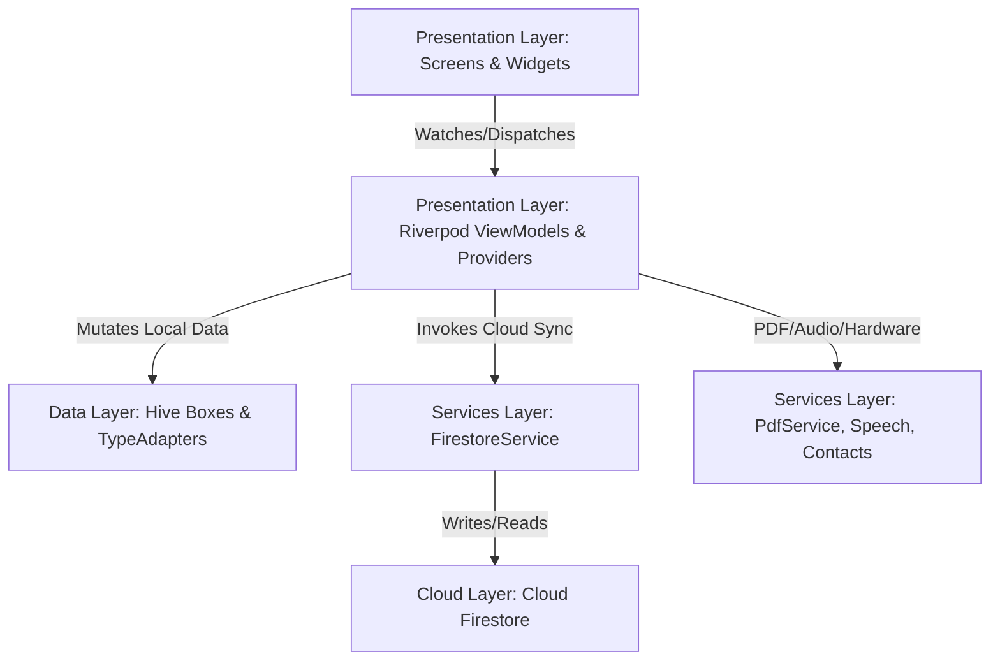

# 01. Architecture — System Architecture

Inka adheres to a **Clean Architecture / Layered Architecture** with strict separation of concerns, reactive unidirectional data flow, and complete offline capability.

---

## 🏛️ Layered Architecture Overview

### 1. Presentation Layer (`lib/presentation/`)
- **Screens**: Pure UI views that observe state via `ref.watch()` and trigger user intentions via `ref.read().notifier`. Screens do not contain direct Firestore or Hive calls.
- **Providers & ViewModels**: Extend Riverpod's `StateNotifier<T>` to maintain state immutability. Handle input validation, transient filtering, and orchestrate synchronization between Hive and Firestore.
- **Widgets**: Reusable, atomic components such as `NavShell`, `WebSidebar`, `PaymentQrSheet`, `RoundedCard`, and `SignaturePad`.

### 2. Services Layer (`lib/services/`)
- Independent, domain-agnostic or feature-specific service classes.
- Examples:
  - `FirestoreService`: Handles all Firebase network I/O, security rules compatibility, and Firestore transactions.
  - `PdfService`: Assembles vector PDF documents and triggers platform print and share dialogs.
  - `CurrencyConversionService` & `CurrencyTaxService`: Fetches current forex rates and formats currency amounts.
  - `DeviceContactService`: Interfaces with native mobile address book APIs.
  - `PaymentQrService`: Generates standardized UPI payment URLs for QR codes.
  - `WhatsAppService`: Constructs pre-filled message links for direct WhatsApp messaging.

### 3. Data Layer (`lib/data/`)
- **Models**: Plain Dart classes with `@HiveType` annotations, `.g.dart` adapters, `toMap()`, and `fromMap()` serializers.
- **Hive Storage**: High-throughput binary NoSQL storage running on device storage.
- **Adapters**: Explicit binary serializers converting objects to byte arrays.

---

## 🔄 Reactive Data Flow & Principles

1. **Unidirectional Data Flow**: User interactions trigger ViewModel methods. The ViewModel mutates the local Hive box first, then updates its internal state object, which automatically re-renders listening UI widgets.
2. **Immutability**: Models provide `.copyWith()` methods to guarantee that state updates produce new instances rather than in-place mutations.
3. **Decoupled Cloud Synchronization**: The cloud layer is treated as a remote replica rather than the primary database. Network drops or offline usage will never interrupt UI rendering or user actions.
